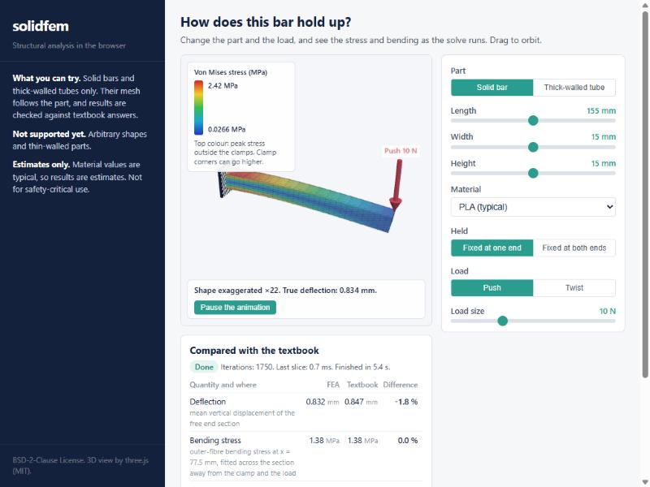

# solidfem

[](LICENSE)
[](https://larsbrubaker.github.io/solidfem/)

**Linear-static structural analysis on tetrahedral meshes, in pure Rust, for native and
`wasm32-unknown-unknown` hosts.**

[](https://larsbrubaker.github.io/solidfem/)

<p align="center"><a href="https://larsbrubaker.github.io/solidfem/"><b>Try the live demo</b></a></p>

solidfem is developed alongside MatterCAD, in a repository of its own so that others can use it
and check it, and it depends on no CAD or GUI code. It takes a tetrahedral mesh, materials, supports
and loads, and solves for displacement and stress with 10-node elements and a conjugate gradient
solver that runs in bounded slices, so a host with no threads can solve between frames and stop
when asked. It contains no C or C++, and two runs on the same input give the same bits.

> Part of the [rust-apps](https://github.com/larsbrubaker/rust-apps) suite, a collection of Rust
> graphics and geometry libraries by Lars Brubaker.

## Status

A wrong "this part is fine" is the worst failure this library can have, so here is exactly where
it stands.

**Works today**

- Solving a tetrahedral mesh you give it: 10-node elements, materials evaluated per integration
  point, fixed nodes, forces and tractions, von Mises results. The validation tests compare it
  with closed-form answers for tension, torsion and cantilevers, a two-material bar, and a printed
  part modelled as a solid shell around a weaker infill core.
- Models that cannot be solved are refused with a specific error, before solving where that is
  possible.
- Solves are resumable and cancellable, and slicing a solve differently does not change its answer.
- Solid bars and thick-walled tubes, as the demo offers them, compared with the textbook on the
  page.
- Exact Delaunay tetrahedralization of a point set, and meshing the solid inside a closed surface
  with its shape kept exactly.

**Does not work yet**

- **Arbitrary parts and thin-walled parts are not ready.** The demo offers only bars and tubes on
  purpose, because their meshes follow the part.
- **The volume-mesher gate has not passed.** That gate (`solidfem-gate`) runs this library's mesher
  into its solver on a 100 x 100 x 0.8 mm plate with two element layers through the wall, against
  beam theory. Until it passes, the path from a general triangle mesh to a trustworthy stress result
  is unproven.
- Only linear statics: no contact, no large deflection, no buckling, no fatigue, no plasticity. A
  stress past the material's yield says the part would yield, not how it would fail.

**Not for safety-critical use.** Material values in the demo are typical values, so its results
are estimates. Do not rely on any of this to decide whether something that can hurt someone is
safe.

## Crates

None of these is on crates.io yet.

| Crate | Folder | What it holds |
|---|---|---|
| `solidfem` | `crates/solidfem` | The facade re-exporting the others, the path from the mesher to a solvable mesh, and the physics validation tests |
| `solidfem-mesh` | `crates/solidfem-mesh` | Tetrahedral meshes from plain arrays, the upgrade to 10-node elements, boundary faces and a structured box builder |
| `solidfem-solve` | `crates/solidfem-solve` | Sparse matrices and a preconditioned conjugate gradient solver that runs in bounded slices |
| `solidfem-elastic` | `crates/solidfem-elastic` | The 10-node tetrahedron, materials, supports and loads, resumable static studies and von Mises results |
| `solidfem-tetra` | `crates/solidfem-tetra` | Exact Delaunay tetrahedralization of a point set, the solid mesher built on it and through-thickness refinement, resumable in slices |
| `solidfem-bench` (never published) | `crates/solidfem-bench` | The end-of-mesher gate and measurements of real triangle meshes, the surface remesher and sliver triangles |
| `solidfem-demo-wasm` (never published) | `demo/wasm` | The WebAssembly engine of the demo page |

## Demo

The [live demo](https://larsbrubaker.github.io/solidfem/) runs the solver in the browser: pick a
bar or a thick-walled tube, change the material and the load, and watch the stress, the bending and
the comparison with the textbook update as the solve runs on the page's main thread, in small
slices, with no worker.

It lives in `demo/`: `demo/wasm` is the engine, the page is TypeScript built with
[Bun](https://bun.sh), and `.github/workflows/deploy-demo.yml` publishes it to GitHub Pages on
every push to `main`. To run it locally you need Bun and `wasm-pack`; from `demo/`:

```sh
bun install
bun run build:wasm     # the WebAssembly engine, into public/pkg
bun run dev            # http://localhost:3040, rebuilding the wasm when Rust sources change
```

`bun run build` writes the static site to `demo/dist`. `bun run preview` serves it on the same
port, and `bun run preview:pages` serves it under `/solidfem/`, as GitHub Pages does.
`bun test` runs the page's tests and `bun run typecheck` the TypeScript check. Three.js is loaded
from a CDN by `demo/index.html`, so the page needs network access.

## Building and testing

The workspace reaches [solidmesh](https://github.com/larsbrubaker/solidmesh) by path, for the
never-published `solidfem-bench` measurements, and solidmesh reaches three more libraries the same
way, so check them out beside this repository:

```
<any folder>/
  solidfem/        github.com/larsbrubaker/solidfem
  solidmesh/       github.com/larsbrubaker/solidmesh
  manifold-rust/   github.com/larsbrubaker/manifold-rust
  clipper2-rust/   github.com/larsbrubaker/clipper2-rust
  tess2-rust/      github.com/larsbrubaker/tess2-rust
```

`rust-toolchain.toml` pins the Rust version (rustup installs it on first use). From `solidfem/`:

```
cargo fmt --check
cargo clippy --workspace --all-targets -- -D warnings
cargo nextest run --workspace     # or: cargo test --workspace
cargo check --target wasm32-unknown-unknown --workspace --exclude workspace-gates
```

The tests include the repository gates (file headers and size, Markdown placement, permissive
licenses and pure-Rust dependencies, third-party notices).

## License

BSD-2-Clause ([LICENSE](LICENSE)). Third-party code is listed, by the crate that carries it, in
[THIRD_PARTY_NOTICES.md](THIRD_PARTY_NOTICES.md).
